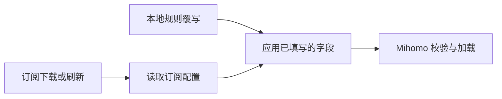

<div align="center">
  
  <h1>Clash Meta for Android</h1>
  <p><strong>分流规则覆写 · Routing Rules Override</strong></p>
  <p>保留订阅自动更新，持续使用自己的分流规则。</p>
  <p>
    <a href="#使用">使用</a> ·
    <a href="#从源码构建">从源码构建</a> ·
    <a href="#english">English</a> ·
    <a href="https://github.com/MetaCubeX/ClashMetaForAndroid">官方上游</a> ·
    <a href="LICENSE">GPL-3.0</a>
  </p>
</div>

## 核心贡献

本分支给 Clash Meta for Android 的「覆写」页增加了**分流规则覆写**。可以粘贴 YAML，也可以从已有配置文件导入。保存后的覆写会在订阅自动更新、手动刷新及配置重新加载时继续应用。

| 字段 | 用途 |
| --- | --- |
| `rules` | 自定义分流规则和匹配顺序 |
| `rule-providers` | 定义供 `RULE-SET` 使用的规则集 |
| `sub-rules` | 定义供规则引用的子规则 |

每个填写的字段都会整段覆写订阅中的对应字段。省略字段会继承订阅值。显式填写空列表或空映射可以清空对应字段。



## 使用

1. 打开 **设置 → 覆写 → 分流规则覆写**，粘贴或编辑 YAML。也可选择 **从 YAML 导入分流规则**。
2. 确认后返回上一级保存。下一次加载配置时应用覆写，可刷新配置或重启连接。
3. 在编辑框中点 **停用**，即可恢复使用订阅规则。

下面示例仅使用 Mihomo 内置策略：

```yaml
rules:
  - DOMAIN-SUFFIX,example.com,REJECT
  - MATCH,DIRECT
```

覆写设置保存在该客户端本地，作用于该客户端加载的所有配置。订阅 YAML 保持原样。规则引用的代理组名称必须与订阅一致，`RULE-SET` 使用的规则集也必须存在。配置校验会报告缺失的引用。

## 从源码构建

构建需要 JDK 21、Android SDK 35、NDK `29.0.14206865`、CMake 和 Go 1.26 工具链。Gradle 版本由 Wrapper 指定，原生构建环境可参考[上游 CI](.github/workflows/build-debug.yaml)。

```bash
git clone --branch routing-rules-override --recurse-submodules https://github.com/Gongkddz/ClashMetaForAndroid.git
cd ClashMetaForAndroid
```

安装 Android SDK 组件后，设置 `ANDROID_HOME`，或在本地 `local.properties` 设置 `sdk.dir`。若要与官方版并存，可在同一文件中设置自己的 `custom.application.id`。

```bash
./gradlew :app:assembleMetaDebug
```

Windows 使用 `gradlew.bat`。如果需要 ARM64 单架构、可常规安装的调试包，可追加 `-Pandroid.injected.build.abi=arm64-v8a -Pandroid.injected.testOnly=false`。

ARM64 调试包已构建，真机已验证 YAML 导入、保存后重新打开和停用。真实 VPN 流量分流仍待验证。

## English

This fork adds persistent routing-rule overrides to **Settings → Override**. Edit, paste, or import YAML for `rules`, `rule-providers`, and `sub-rules`. Supplied fields replace their subscription counterparts in full. Omitted fields inherit the subscription value. The Android client applies the overrides during configuration validation and loading, including after automatic subscription updates.

Overrides are global to this app. The downloaded YAML is preserved. Referenced policies and rule providers must exist in the effective configuration.

## 许可与上游

本项目是 [MetaCubeX/ClashMetaForAndroid](https://github.com/MetaCubeX/ClashMetaForAndroid) 的 GitHub fork，沿用 [GPL-3.0](LICENSE)。感谢 Clash Meta for Android 与 [Mihomo](https://github.com/MetaCubeX/mihomo) 的维护者。YAML 导入使用 [SnakeYAML](https://bitbucket.org/snakeyaml/snakeyaml)。

上游项目的自动化接口和维护说明见[基线 README](https://github.com/MetaCubeX/ClashMetaForAndroid/blob/6e635124cc72f8c102b7e76d849c384deba28b3f/README.md)。
